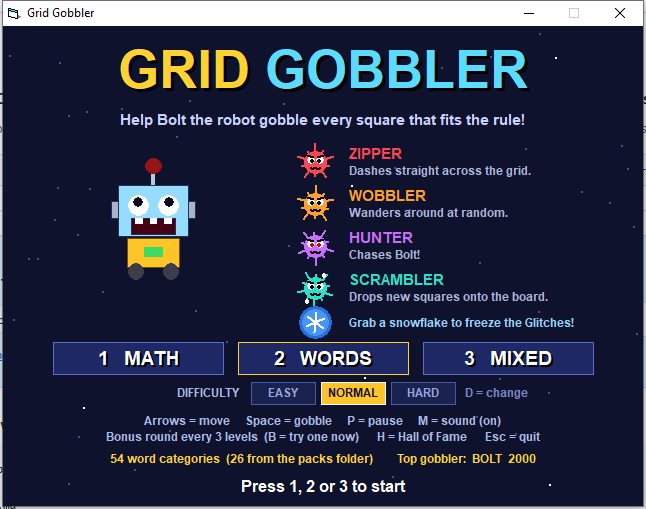
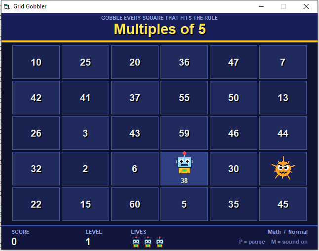
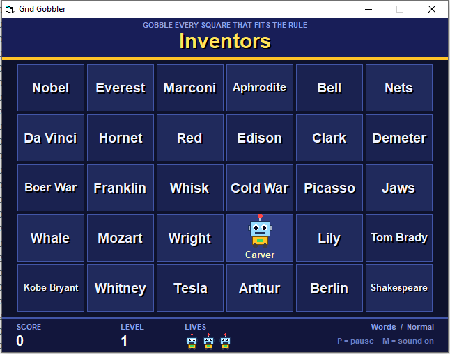
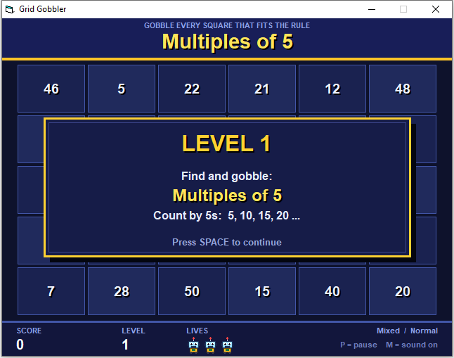
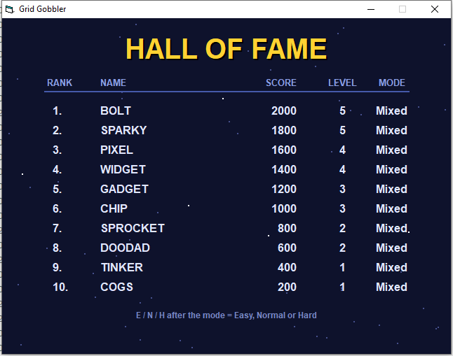
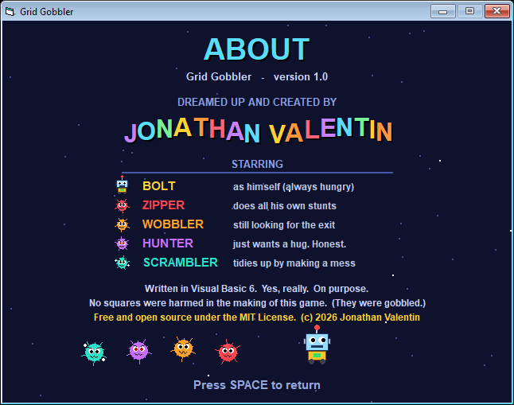
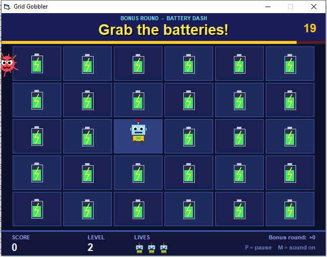
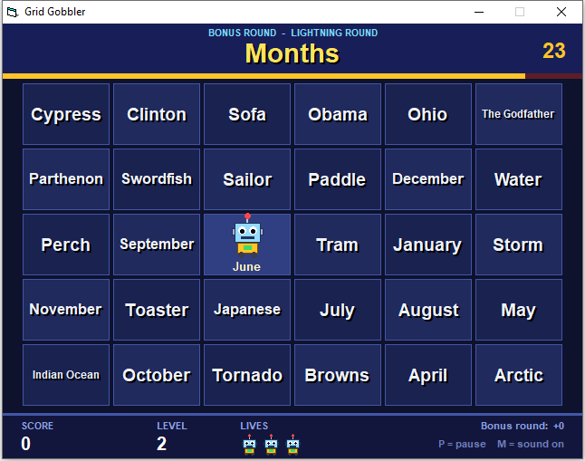
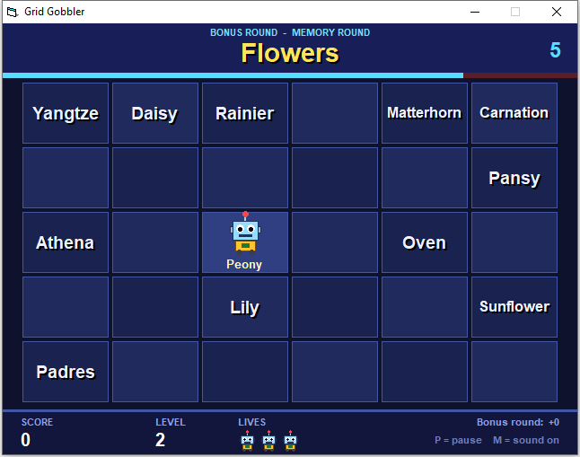
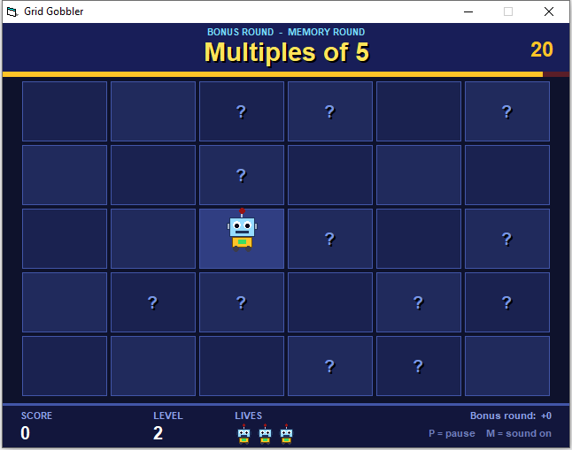

# Grid Gobbler

A retro educational arcade game written in Visual Basic 6. Steer Bolt the robot
around a grid and gobble every square that fits the rule at the top of the
screen, while dodging the Glitches that roam the board.

It is an original game in the spirit of the classic "eat the right answers"
edutainment games of the early 1990s. All code, characters, artwork and sounds
are original; everything is drawn and synthesised in code, so there are no
image or audio files.



## Screenshots

| Math | Words |
|---|---|
|  |  |

| Level intro with clue | Hall of Fame |
|---|---|
|  |  |

| About and credits |
|---|
|  |

**Bonus rounds**

| Battery Dash | Lightning Round |
|---|---|
|  |  |

| Memory Round: memorise... | ...then find them |
|---|---|
|  |  |

## Features

- **Three modes:** Math, Words, or Mixed (alternates between the two).
- **Math rules:** multiples, factors, primes, even/odd, square numbers,
  greater/less than, and sums that equal a target.
- **54 word categories:** 28 built in, plus 26 loaded from text files in
  `packs/` (geography, history, movies, TV shows, sports and more).
- **Three difficulty levels:** Easy, Normal and Hard change your lives, how
  fast and how often Glitches appear, and how much everything is worth.
- **Four Glitches:** Zipper dashes straight across, Wobbler wanders, Hunter
  chases Bolt, and Scrambler drops new squares onto the board.
- **Three bonus rounds**, one every third level: Battery Dash, Lightning Round
  and Memory Round.
- **Combos, perfect-level bonuses and extra lives** for accurate play.
- **Snowflake power-up** that freezes every Glitch for a few seconds.
- **Hall of Fame** (top 10) and remembered difficulty/sound settings.
- **Animated About screen** with the credits and a Glitch chase.
- **Add your own categories** with a text editor. No programming needed.

## Running the game

Requires Windows. Download or clone the repository and run `GridGobbler.exe`.
Keep the `packs` folder next to the EXE.

The game uses the Visual Basic 6 runtime (`MSVBVM60.DLL`), which is included
with Windows, so there is nothing to install.

## Controls

| Key | Action |
|---|---|
| Arrow keys | Move Bolt |
| Space / Enter | Gobble the current square |
| P | Pause |
| M | Sound on/off |
| Esc | Pause; press again to return to the title screen |

On the title screen:

| Key | Action |
|---|---|
| 1 / 2 / 3 | Start a Math / Words / Mixed game |
| D or Left/Right | Change difficulty |
| B | Practise a bonus round (cycles through all three) |
| H | Hall of Fame |
| A | About and credits |
| Esc | Quit |

## How to play

1. Read the rule, for example "Multiples of 5" or "Inventors".
2. Move onto a square that fits and press Space to gobble it.
3. Gobble every correct square to finish the level.
4. A wrong answer or a touch from a Glitch costs a life.

Correct answers in a row build a combo multiplier (up to x4). Finishing a level
with no mistakes and no zaps earns a perfect-level bonus, and you earn an extra
life every 2,000 points (4,000 on Normal, 6,000 on Hard).

| | Easy | Normal | Hard |
|---|---|---|---|
| Starting lives | 5 | 3 | 3 |
| Score multiplier | x1 | x2 | x3 |
| Glitches | Fewer, slower | Standard | More, faster |
| Hunters and Scramblers | Appear later | Standard | Appear early |

## Adding your own categories

Every `.txt` file in the `packs` folder is loaded when the game starts. To add
categories, edit one of the files or drop in a new one, then restart the game.
No rebuild is needed.

```ini
; Lines starting with ; are comments

[Dinosaurs]
is=a dinosaur
clue=They ruled the Earth millions of years ago.
yes=Triceratops,Stegosaurus,Velociraptor,Brachiosaurus,Allosaurus
yes=Iguanodon,Ankylosaurus,Spinosaurus,Raptor
no=Mammoth,Pterodactyl,Sabertooth,Crocodile
```

| Line | Meaning |
|---|---|
| `[Title]` | The rule shown at the top of the screen |
| `is=` | Finishes the sentence "Mammoth is not ____." |
| `clue=` | Hint shown when the level starts (optional) |
| `yes=` | Right answers, comma separated. At least 4; 8 or more works best. You can use several `yes=` lines. |
| `no=` | Tricky wrong answers (optional) |

Tips:

- Keep answers to about 13 characters so they fit in a square.
- Other wrong answers are borrowed from the rest of the categories, so avoid
  categories that overlap. A "European Countries" pack would put real
  countries on the built-in "Countries" board as wrong answers.

Included packs:

| File | Categories |
|---|---|
| `sample-pack.txt` | Dinosaurs, Capital Cities (also documents the format) |
| `geography.txt` | Rivers, Mountains, Oceans and Seas, Deserts, Famous Landmarks |
| `history.txt` | U.S. Presidents, Inventors, Explorers, Ancient Peoples, Wars, Greek Gods |
| `movies.txt` | Animated Movies, Classic Movies, Movie Genres, Superheroes |
| `tv-shows.txt` | Sitcoms, TV Cartoons, Game and Reality Shows |
| `sports.txt` | Sports Equipment, Sports Terms, Sports Legends, NFL Teams, NBA Teams, MLB Teams |

## Building from source

You need Visual Basic 6.0 (Service Pack 6 recommended).

- **IDE:** open `GridGobbler.vbp` and choose File > Make GridGobbler.exe.
- **Command line:**

  ```bat
  "C:\Program Files (x86)\Microsoft Visual Studio\VB98\VB6.EXE" /make GridGobbler.vbp /out build.log
  ```

There are no third-party controls or references; the project uses only the
VB6 runtime and a few Win32 API calls.

| File | Purpose |
|---|---|
| `GridGobbler.vbp` | Project file |
| `frmGame.frm` | The game: states, input, game loop and all drawing |
| `modRules.bas` | Math rules, built-in categories and the pack loader |
| `modSound.bas` | Sound effects generated in memory as square-wave WAVs |
| `modScores.bas` | Hall of Fame and settings files |
| `packs/` | Category packs (plain text) |

The game writes two small files next to the EXE: `gobbler.hi` (high scores)
and `gobbler.cfg` (difficulty and sound). Both are in `.gitignore`.

## License

[MIT](LICENSE)
